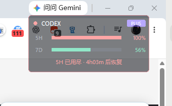
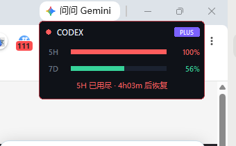

# Codex Gauge · 额度悬浮窗

[](https://github.com/adam0718/codex-gauge/releases)
[](https://www.python.org/)
[](#)

一个常驻桌面的极简悬浮窗，实时显示你 Codex 账号的额度消耗。

鼠标移开时半透明淡出、几乎不占视线；鼠标移上去立刻恢复清晰。额度快见底时边框会变红提醒。

| 淡出状态（鼠标不在） | 清晰状态（鼠标悬停） |
| --- | --- |
|  |  |

> 截图里 7D 的「打满」预测是用演示数据渲染的，实际数值随你的真实用量变化。

## 怎么用

**双击 `启动 Codex 额度浮窗.bat`** 就行。窗口会出现在屏幕右上角。

不需要安装任何东西 —— 只用 Python 标准库。前提是你机器上已经装了 Python 3.9+（带 tcl/tk）。

## 界面说明

```
● CODEX                    [PLUS]
5H  ████████████████████  100%      ← 5 小时滚动窗口
7D  ██████████░░░░░░░░░░   56%      ← 7 天滚动窗口
5H 已用尽          7D 明 01:53 打满  ← 预测：按当前速度何时会满
        重置 5H 18:26 · 7D 10-27      ← 重置时刻
```

- 颜色：< 60% 绿、60–85% 黄、≥ 85% 红
- 任一窗口打满时，卡片描边变暗红
- 数字每 60 秒自动刷新一次

### 预测行怎么读

第三行是**预测**，不是当前状态。它回答一个问题：*照这个速度烧下去，会不会在重置之前先见底？*

| 显示 | 含义 |
| --- | --- |
| `5H 15:40 打满` | 按当前速率，15:40 会到 100%。黄色=还有 1 小时以上，红色=不到 1 小时 |
| `5H 不会打满` | 算下来重置会先发生，不用管 |
| `5H 采样中` | 刚开始跑，样本还不够算速率（等 1–2 分钟） |
| `5H 已用尽` | 已经 100%，没什么可预测的了 |

**算法**：每次刷新记一个采样点（时间 + 用量），取最近 6 个点算平均速率（%/小时），再用「剩余百分比 ÷ 速率」推出打满时刻。如果推出来的时刻晚于重置时刻，就判定为「不会打满」。

**它自己会发现重置**：用量突然掉下来（跌幅超过 5 个百分点）就视为窗口已重置，历史采样清空重算，不会把重置前的数据混进来。

> 预测基于**你最近几分钟的消耗速度**，不是长期平均。如果你接下来突然停手，它不会预知；如果你突然狂用，它也要等下一个采样点才反应过来。这是"按当前趋势外推"，不是预言。

## 操作

| 操作 | 效果 |
| --- | --- |
| 鼠标移入 | 恢复完全不透明 |
| 鼠标移出 | 淡出到 55% |
| 左键拖动 | 移动位置，位置自动记住 |
| 双击 | 立即刷新 |
| 右键 | 菜单：刷新 / 重置位置 / 显示样式 / 跟随 Codex / 账号 / 透明度 / 退出 |

右键菜单里的「淡出透明度」可以选 40% / 55% / 70% / 85%。

## 显示样式

右键 → **显示样式** 可以在两种形态间切换：

| 样式 | 尺寸 | 位置 |
| --- | --- | --- |
| 卡片 | 252×142 | 可拖到任意位置，记住坐标 |
| 任务栏细条 | 250×30 | 自动贴在工作区底边（任务栏上沿），靠右 |

细条只保留两条进度和百分比，适合不想让浮窗占桌面空间的情况：

```
5H ████████████ 100%    7D ██████ 56%
```

### 为什么不能真的嵌进任务栏

查过了，两条路都走不通：

1. **DeskBand**（IE 时代往任务栏里塞自定义面板的官方方式）：微软在 Win11 里移除了对第三方 DeskBand 的支持，这条路已经关了
2. **直接盖在任务栏上**：任务栏窗口的扩展样式是 `WS_EX_TOPMOST | WS_EX_TOOLWINDOW`，是系统保护层，普通应用窗口（哪怕也设了 topmost）压不上去

所以做成"紧贴任务栏上沿的一条细缝"——视觉上像是任务栏的延伸，但不遮挡任务栏本身的任何图标。间距 6px，圆角 8，配色和任务栏接近。

如果你更想要真正的"系统组件感"，唯一的正路是做一个独立的 Windows 小工具用 C++ 写 Taskbar Extension——那是另一个量级的工程，且 Win11 上同样受限。

## 跟随 Codex 启动

右键菜单勾选「跟随 Codex 启动」后，浮窗每 3 秒看一眼 Codex 进程：

- Codex 在跑 → 窗口出现
- Codex 关掉 → 窗口自动收起
- 再打开 Codex → 窗口自己回来

**前提是浮窗本身得在后台待命**，所以还要装开机自启：

```bash
python tools/autostart.py install     # 安装
python tools/autostart.py status      # 查看当前状态
python tools/autostart.py uninstall   # 取消
```

安装时优先往「启动」文件夹放脚本，你能在 `shell:startup` 里直接看到并删除。如果这台机器拒绝写入（装了安全软件或开了「受控文件夹访问」的机器会拒），会自动降级到注册表 `HKCU\Software\Microsoft\Windows\CurrentVersion\Run`，并在输出里明确告诉你用了哪种。

> 本机实测：启动文件夹写入被系统拦截，实际落在注册表。要撤销就运行上面的 `uninstall`，不用自己去翻注册表。

**窗口不见了怎么找回来**：再双击一次 `启动 Codex 额度浮窗.bat`。程序发现已有实例时，会让它显形并自动关掉跟随模式——不会把你锁在窗口外面。

**为什么不直接挂 Codex 的钩子**：Codex 的 `config.toml` 只有 `notify`（每轮对话结束时触发），没有启动钩子；它也不支持外部注册启动回调。所以只能由浮窗侧轮询进程。3 秒一次的开销是一次内存快照遍历，微秒级，比每 3 秒调一次 `tasklist` 省得多。

## 多账号切换

右键 → **账号** → 点一个就切过去了。每个账号的用量缓存和预测采样各自独立，不会串。

### 怎么加第二个账号

Codex 同一时间只登录一个账号，多账号靠「一个账号一套配置目录」隔离：

```bat
set CODEX_HOME=%USERPROFILE%\.codex-work
codex login
```

登录完回到浮窗：右键 → 账号 → **重新扫描**，新账号就出现了。

目录名随意，只要以 `.codex` 开头（`.codex-work`、`.codex-alt`…），浮窗会自动扫出来，标签取后缀部分。

### 关于安全，说清楚

你要求「账号密码绝对保存在本地，不上传云端、不传网络」。这个工具的实际行为是：

| 事项 | 实际情况 |
| --- | --- |
| 保存账号密码 | **从不**。浮窗没有登录功能，也不需要密码 |
| 复制 token | **从不**。只读 `auth.json` 里的 `access_token` 用于发请求，不写进任何文件 |
| 写回 Codex 凭证 | **从不**。不刷新、不修改，避免破坏你的登录态 |
| 上传到云端 | **没有这个功能**。没有服务器、没有账号体系、没有遥测 |
| 联网行为 | 只有一种：向 `chatgpt.com` 查额度，直连官方接口 |

**有一点必须说清**：查额度这个动作，本身必须把 token 发到 `chatgpt.com`——否则 OpenAI 无法判断你是谁，也就算不出用量。这是**直连官方接口**，不经过任何第三方服务器，跟「上传到云端」是两件事。如果连这个也不接受，那只能不装这个工具。

浮窗自己唯一写的文件是 `%APPDATA%\CodexGauge\` 下的两个 json：界面设置（位置、透明度、当前账号路径）和用量缓存（百分比数字，不含凭证）。

**切换账号只是换一个读取路径**，凭证始终留在各自的 Codex 目录里，由 Codex 自己管理。

## 数据从哪来

读本机 Codex 的登录凭证（`~/.codex/auth.json`），调用 ChatGPT 官方用量接口拿实时数据。多账号时读的是对应目录的 `auth.json`。

凭证**只读不写**：不替你刷新 token（刷新留给 Codex CLI 自己做，避免把你的登录态搞坏）、不复制、不落盘到别处。完整的隐私说明见上面「多账号切换 → 关于安全」。

## 配置

`%APPDATA%\CodexGauge\config.json`

```json
{
  "idle_alpha": 0.55,        // 鼠标不在时的透明度
  "hover_alpha": 1.0,        // 鼠标悬停时
  "refresh_seconds": 60,     // 刷新间隔（最小 15）
  "pos": null,               // 窗口位置，null = 默认右上角
  "rounded": true,           // 圆角卡片；若渲染异常可改 false
  "follow_codex": false,     // 是否跟随 Codex 显示/隐藏
  "active_account": null,    // 当前账号的 Codex 目录路径
  "layout": "card"           // 显示样式：card 卡片 / compact 任务栏细条
}
```

改完重启生效。右键菜单改透明度会自动写入。

## 常见问题

**窗口没出现？**
先确认 `python -c "import tkinter"` 不报错。某些精简版 Python 不带 tcl/tk，重装时勾选上即可。启动器会自动跳过没有 tkinter 的解释器。

**显示「凭证已过期」？**
打开一次 Codex CLI 让它自己续期，浮窗下一轮刷新就会恢复。

**显示「网络不可用」？**
访问 chatgpt.com 需要能连通。工具本身带了两次重试，偶发抖动能自愈；持续失败时保留上次数据并标注。

**想让窗口不挡鼠标点击？**
当前版本没有做鼠标穿透，因为那样就没法拖动和右键了。如果你更想要「纯展示、可点击穿透」的模式，可以加，告诉我就行。

## 文件结构

```
codex-gauge/
├─ 启动 Codex 额度浮窗.bat   启动器（双击即可）
├─ src/codex_gauge.py        全部源码，单文件
├─ tools/autostart.py        开机自启管理（install / status / uninstall）
├─ tests/                    单测：test_forecast（预测 12 条）、test_accounts（多账号 11 条）
├─ docs/                     效果图
├─ PROJECT.md                项目背景
├─ TASKS.md                  待办
├─ DECISIONS.md              技术决策记录
└─ CHANGELOG.md              版本变更
```

## 已知限制

- 仅支持 Windows（依赖 Win32 分层窗口做圆角 + 可变透明）
- 非官方接口，ChatGPT 若调整接口字段需要跟进更新
- 单一实例：重复启动只会保留第一个窗口
